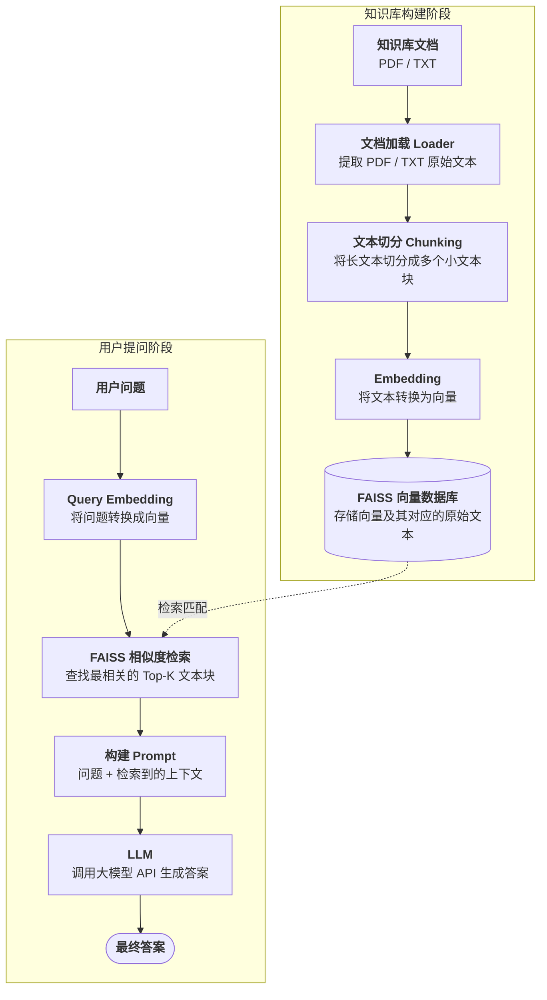

### 简易 RAG 系统架构




    simple_rag/
    │
    ├── data/                       # 存放原始知识库
    │   ├── python.pdf
    │   ├── langchain.txt
    │   └── rag.pdf
    │
    ├── vector_db/                  # 持久化向量数据库
    │   ├── faiss.index
    │   └── metadata.json
    │
    ├── config.py                   # 配置
    ├── document_loader.py          # 文档加载
    ├── text_splitter.py            # 文本切分
    ├── embedding.py                # Embedding
    ├── vector_store.py             # 向量存储和检索
    ├── llm.py                      # 大模型调用
    ├── rag.py                      # RAG 主流程
    └── main.py                     # 程序入口

每个模块只负责一件事：

| 文件                 | 负责的事情           |
| ------------------ | --------------- |
| document_loader.py | 从 PDF、TXT 中提取文本 |
| text_splitter.py   | 将文本切分成 Chunk    |
| embedding.py       | 文本转换为向量         |
| vector_store.py    | 向量保存、加载、检索      |
| llm.py             | 调用大模型           |
| rag.py             | 把各个模块组合起来       |
| main.py            | 运行程序            |

三、安装依赖
建议先创建 Python 虚拟环境。

```bash
pip install pymupdf
pip install sentence-transformers
pip install faiss-cpu
pip install numpy
pip install openai
```

各个依赖的作用：

| 依赖                    | 用途           |
| --------------------- | ------------ |
| pymupdf               | PDF 文本提取     |
| sentence-transformers | Embedding 模型 |
| faiss-cpu             | 向量索引和相似度检索   |
| numpy                 | 向量计算         |
| openai                | 调用大模型 API    |

Embedding 模型使用：

`BAAI/bge-small-zh-v1.5`

它适合中文文本的语义向量化。第一次运行时需要下载模型。

说明：

（1）
Min-Max 缩放：把任意范围的数据，等比例压缩或拉伸到指定区间
$$X_{\text{new}} = \frac{X - \text{Min}}{\text{Max} - \text{Min}}$$
具体代码解释：
把 `[-1,1]` 缩放到 `[0,1]` 之间
最小值：-1
最大值：1
套入公式：
$$\text{similarity\_pct} = \frac{\text{cosine} - (-1)}{1 - (-1)} = \frac{\text{cosine} + 1}{2}$$
几何理解：
1. **`+ 1`（平移区间）**：把原本 `[-1, 1]` 的范围整体向右移动 1 个单位，变成 `[0, 2]`（消除了负数）。
2. **`/ 2`（缩放比例）**：把 `[0, 2]` 的范围除以 2，压缩进 **`[0, 1]`** 之间。
